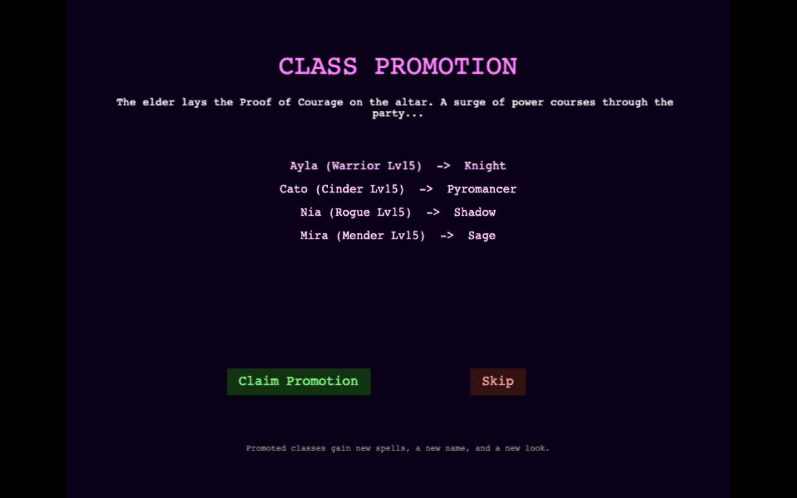
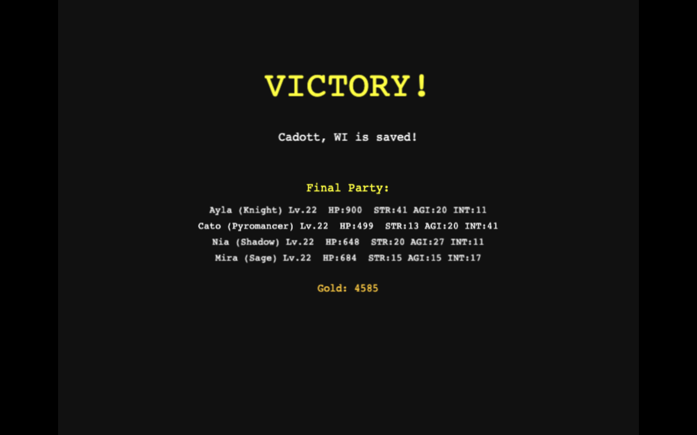

# Existing campaign readiness — 2026-09-04

This pass concerns the existing fallback campaign. It does not certify the new
Old Mill adventure or close a broader visual/content issue.

**Completed:** the same fresh save reached victory with all 24 quests complete,
all four characters promoted at level 15 and finishing at level 22. Repairs
shipped in PR #301. The natural audit passed its final 24-minute continuation;
its earlier segments and ordinary save resumes are described below.
[Durable metrics](proofs/readiness/20260904-1788535559978-summary.json) and
[the final victory screenshot](proofs/readiness/20260904-1788535559978-campaign-victory.png)
record the completed result.

## Simulator diagnosis

The initial CLI command reproduced the audit exactly: seeds 1–10 yielded 27/30
victories, with promotion means 10.86, 12.10, and 12.20 failing a [2, 5] band.
This was a stale CLI expectation. Commit `ae5ea101` (#121) flattened the XP
curve, scaled encounter XP, and changed `make simulate` to 10 ± 3. The CLI
still used 3.5 ± 1.5. The correction centralizes the existing Makefile thresholds
in the CLI; it changes no XP, monsters, encounter rates, or campaign content.
The maximum wipe threshold also now matches Make's existing 0.45 rather than
the CLI's looser 0.80. The existing minimum victory threshold is unchanged.

Design §4.5 makes promotion story-triggered; §10.4 places it after Act 1. The
current generator uses 5–8 Act-1 quests before the trial, with later acts and
side quests bringing these sampled campaigns to 21–26 quests. The design
text's earlier quest counts and XP table do not fully describe current content.
This pass preserves the shipped story gate and records that documentation drift
instead of retuning the game to an obsolete assertion.

Two disjoint sets of 100 seeds per strategy provide 600 campaigns total. A
100-run strategy sample has a worst-case binomial standard error of five
percentage points, materially better than the initial ten-run smoke sample.
These are regression samples, not estimates of a child's chance of finishing.

| Seeds     | Strategy     | Victories | Mean promotion level | Mean final leader level among victories |
| --------- | ------------ | --------- | -------------------- | --------------------------------------- |
| 1–100     | aggressive   | 80/100    | 10.56                | 21.11                                   |
| 1–100     | cautious     | 93/100    | 11.78                | 24.25                                   |
| 1–100     | healer_heavy | 100/100   | 11.82                | 24.20                                   |
| 1001–1100 | aggressive   | 73/100    | 10.08                | 20.29                                   |
| 1001–1100 | cautious     | 93/100    | 11.56                | 24.02                                   |
| 1001–1100 | healer_heavy | 98/100    | 11.67                | 24.20                                   |

The simulator's historical promotion metric samples the leader, then averages
across runs that reached promotion. It is not the mean of all four characters.
The help text and metric comments now say so. The policy injects eight
encounter requests per quest, then submits normal quest-node actions without
walking the map. It does not shop, make rest trips, or model human input time.
Its promotion levels cannot be treated as measurements of browser travel pacing.

Reproduction from `server/`:

```sh
go run ./cmd/simulate -runs 100 -seed 1 -shared=../shared -out ../client/tmp/readiness/seeds-1-100.json
go run ./cmd/simulate -runs 100 -seed 1001 -shared=../shared -out ../client/tmp/readiness/seeds-1001-1100.json
```

Both reports include the seed range, strategy names, difficulty, turn cap, and
encounter policy. Both passed all statistical and quest-order checks.

## Browser regression repairs

The older full-loop test waited for `CONTINUE` while the current button says
`Continue`. It also assumed old shop labels, an obsolete canvas equipment
picker, and a Phaser-only Escape event for the now-DOM Character dialog.
Selectors now use the case-insensitive interactive text bridge for canvas UI
and accessible roles plus the existing equipment-slot contract for DOM UI.
Assertions still check combat logs, purchase effects, equipped items, earned XP,
saved state, promotion, and the final quest. The fallback that warped beyond
the last quest to manufacture victory is removed.

Proof images are unobstructed screenshots under unique `client/tmp/readiness/`
run directories. State and labels are separate JSON artifacts, so a diagnostic
HTML overlay no longer hides the game being inspected.

The door handler previously entered Town after any quest result. The phase
guard now routes combat, promotion, victory, and defeat through World's existing
phase handling before an interior opens. Four regression cases fail before the
fix and pass afterward. The full-loop proof uses actual door interaction for
those campaign milestones, with its position/quest setup explicitly marked as
debug-assisted. DebugWarpQuest only changes the selected index; the regression
therefore checks that the final door action completes the final quest and moves
the index to the end. The separate natural test checks every quest.

A second actual blocker appeared on repeat interior visits: Phaser reuses Town,
but its `_exiting` flag remained true after the first exit. Resetting that flag
in `init` allows the next visit to leave normally. A regression exercises two
visits on the same scene instance, failing before the fix and passing after.
This minimal fix was shared with the separate inn task as commit `7a479e4`.

## Evidence boundaries and remaining risks

- The full-loop regression uses debug encounters, forced victories, quest
  warps, and position setup. It verifies transitions and UI/state contracts;
  it is not a natural campaign playthrough.
- The separate readiness campaign uses wizard creation, a seeded server RNG,
  real keyboard travel and random encounter rolls, normal combat requests,
  and the player's supported fast battle/message/walk settings. The automation
  selects commands through the existing scene submission path. It rejects
  debug and OSM requests. It is automated normal progression, not a manual
  usability study or a deterministic measure of travel time.
- The startup timeout recurred on the first 800×600 run of this fresh worktree.
  Other sizes and subsequent startup checks passed. The cause remains
  unconfirmed; no startup fix or longer timeout is claimed. Dedicated startup
  proof records active scene, loader state, failed requests, and console errors.
- Phone Title/shop/promotion screens retain desktop-style composition and can be
  small within a tall viewport. This pass does not redesign menus or art.
- Victory reward rows currently repeat the total party XP award next to each
  surviving character. The server divides the award among eligible characters;
  the display can overstate each character's gain. This existing presentation
  mismatch is recorded rather than interpreted as a server progression bug.
- Non-promotion quest actions currently complete on arrival at their target.
  In particular, reaching the final quest target can complete the campaign
  without a separate final-boss battle. Completion evidence must not be called
  proof of a final-boss combat system. Expanding quest action execution is
  outside this regression repair.

## Validation

Passed: `make test`; `cd server && go vet ./... && go build ./...`;
`cd server && go test -race ./...`; `cd client && npm test` (473 tests);
`cd client && npm run build`; and both 300-campaign samples above.

Pinned CI lint passed with zero issues:

```sh
cd server &&
GOTOOLCHAIN=go1.24.0 go run github.com/golangci/golangci-lint/v2/cmd/golangci-lint@v2.1.6 run --timeout=5m ./...
```

The installed v2.7.2 reports G602 at unchanged `internal/locality/tilemap.go:766`.
Inspection confirms the A\* path checks every returned coordinate inside map
bounds before appending it. The CI-pinned v2.1.6 passes. No out-of-bounds failure
was reproduced and no lint suppression or unrelated map edit was made.

The repaired full-loop regression passed in 44.2 seconds. The three startup
sizes passed in 1.8, 1.5, and 1.4 seconds (including screenshots); recorded loader
state reached progress 1 with no pending/inflight files or page errors. Chromium
reported ReadPixels performance warnings. The natural harness initially selected
battle speed 6, which is slowest; it now selects the supported fastest setting 1.
It also now handles the asynchronous World-to-Battle transition while waiting
for a walking tween, rather than waiting forever on the inactive World scene.

Inspected debug-assisted artifacts are under
`client/tmp/readiness/debug-1788533526218/`: `world-start.png`, `encounter.png`,
`shop-compare.png`, `shop-overlay.png`, `level-up.png`, `save-load.png`,
`promotion.png`, and `victory.png`. Promotion guardian entry was also inspected
at `client/tmp/readiness/debug-1788533439565/boss-battle.png`.

The Cadott world/shop round trip passed at 800×600, 1280×720, and 390×844
(16.2s, 16.0s, 20.6s). Inspected artifacts under
`client/tmp/cadott-gold-slice/proof/` include all three
`issue-267-<size>-shop-equipment-comparison-1788533659451.png` images,
`issue-267-1280x720-exterior-arrival-1788533659451.png`, and
`issue-267-390x844-overworld-round-trip-complete-1788533659451.png`.

## Natural session measurements

The initial ten-minute diagnostic completed 37 battles (74 combat rounds),
started a 38th, completed one quest, bought an item, rested, and restored a save
with matching party/inventory/equipment/gold/quest state. It used both potions
and spells with corresponding combat log evidence. All four characters reached
level 6. No debug or OSM request or page error occurred.

This was not ten minutes spent pursuing the first quest directly. The test
visited services first. Shortest legal tile routes on the generated map are
approximately 90 tiles to the shop, 138 from shop to inn, and 103 from inn to
the first objective, versus 75 directly from the initial spawn to that objective.
That testing detour is a major confounder. The complete prescribed itinerary is
about 1,931 walkable tiles over 28 stops, including the three-stage promotion
trial. The harness uses breadth-first shortest legal routes, recalculated after
movement, and never disables encounters. It does not currently prefer safer
roads over shorter grass routes.

The ten-minute cap expired during active combat, not at an action watchdog.
The separate long campaign diagnostic now budgets up to an hour based on the
measured route and first 38 encounters, with a 30-second combat-round watchdog
and 15-second action waits. This does not increase the legacy regression's
120-second cap or change game tuning. It writes ordinary server save checkpoints
every five battles and at quest visits, with local journal and route metrics.
`READINESS_RESUME` accepts the path to a generated `checkpoint.json`, so an audit
can continue the same save after interruption. No authentication tokens are
written to these artifacts.

The initial fresh-save evidence is in
`client/tmp/readiness/campaign-1788533712475/`: `first-battle.png`,
`first-victory.png`, `shopping.png`, `rested-inn.png`, `save-reloaded.png`, and
`journal.json`. The continuation uses that user's latest ordinary pre-combat
autosave. The API's normal load behavior resumes in the overworld; the audit
records the new starting position rather than moving it to an assumed location.

The continuation completed successfully; final metrics appear below.

## Integrated repair gate

After rebasing onto `6cd1cc4` (merged bestiary and inn), `make test`, all 482
client tests, the production build, and the full client formatting check passed.
Nine browser checks passed in 1.6 minutes: three Cadott sizes, full-loop (24.1s),
two actual Title save/load flows, and three startup sizes.

The normal Title load flow exposed an orphaned email input over the World.
Phaser DisplayList `removeAll(true)` means skip removal callbacks, not destroy
objects. Title had emptied its list before looking for DOM elements, leaving
native inputs outside scene cleanup. It now destroys a snapshot of owned menu
objects before building the next screen. The targeted regression failed before
the fix and passed afterward. The browser proof clicks the real save row and
asserts matching saved party/gold and no email input in either the load menu or
World. Inspected desktop/phone screenshots:
`client/tmp/readiness/load-1788535453606/{1280x720,390x844}-{save-menu,loaded-world}.png`.

At the repair merge, the natural audit had reached quest 6/24 and preserved an
ordinary manual checkpoint after battle 75. The first continuation measured 96-, 83-, and
110-tile shortest routes with 8, 6, and 9 encounters respectively. Its 53 timed
rounds at an intermediate checkpoint averaged 3.9 seconds, maximum 6.2 seconds.
These timings include automated submission and rendered presentation, not a
manual-play speed measurement. Its earlier `steps` field counted key presses;
the harness now separately records key presses and coordinate deltas so held
keys cannot undercount actual tiles. Checkpoint journals are frozen per save ID,
so later failed or interrupted attempts cannot overwrite a resume checkpoint's
provenance.

## Completed natural campaign

The final continuation of `readiness-campaign.spec.js` passed in 24.0 minutes.
The combined saved-session journal contains 143 completed battles and 270
combat rounds: 142 rounds ended in `quest_complete`, one guardian round ended
in `world`, and 127 rounds continued in `combat`. The first two outcomes count
as 143 completed battles. The journal has only 106 explicit `battle` records
(numbered 39–144), because that record type was added after the initial 37 wins.
The attempt counter reads 144 because the initial ten-minute segment was
interrupted during attempt 38; that unfinished attempt is not counted as a
completed battle. Both potions and spells have combat-log evidence.
There were no page errors or debug/OSM requests.

| Outcome                   | Observed result                                                           |
| ------------------------- | ------------------------------------------------------------------------- |
| Quests                    | 24 of 24 completed; final phase `victory`                                 |
| Party                     | Knight, Pyromancer, Shadow, Sage; all level 22 and at full HP             |
| Promotion                 | Trial began at level 11, guardian defeated at 14, promotion claimed at 15 |
| Final gold                | 4,585                                                                     |
| Last continuation travel  | 1,133 actual tiles / 1,133 summed shortest-path tiles across 21 legs      |
| Last continuation battles | 68 travel encounters plus the promotion guardian                          |
| Timed combat rounds       | 196 samples: mean 3.63s, maximum 7.58s; initial 74 rounds were not timed  |

All four characters were level 20 immediately before the final quest reward,
which raised them to 22. The promotion level differs from the simulator samples:
this session gained XP from the real giver/guardian/return journeys as well as
its initial service detour. The simulator uses its fixed encounter-request policy
and does not walk those routes. Neither result justifies retuning global content
to fit the other's measurement.

Twelve later legs needed only a one-tile approach at a repeated target. The
last two long journeys had zero encounters because the game had normally
unlocked T5 Airship with `encounter_rate_mult: 0`; the harness did not disable
encounters. Many post-promotion objectives complete by returning to the same
Old Ruins door, including the final quest. This is campaign-completion evidence,
not proof that each quest type or a separate final-boss fight is implemented.

The audited runtime tree was `37ef377`, byte-identical in Git to the merged
`308dcd5`. The evidence update is based on main `c9a1286`, which also contains
the later monster pack and Old Mill adventure. This audit does not certify those
later additions. The 24-minute duration covers the final uninterrupted
continuation, excluding the earlier ten-minute diagnostic, the segment paused
for Title cleanup, and implementation/review time. Ordinary save resumes reset
the overworld starting position; no position was restored with a debug mutation.
Automated routing, rendering, and checkpoint overhead also make these timings
unsuitable as a manual-play duration estimate.

The exact successful continuation command, from the repository root, was:

```sh
READINESS_RESUME="$PWD/client/tmp/readiness/campaign-1788534572964/checkpoint-frozen.json" ./scripts/run_playwright_local.sh e2e/readiness-campaign.spec.js --output=tmp/readiness/continued-integrated-20260904
```

Reproduce a new session from the repository root:

```sh
./scripts/run_playwright_local.sh e2e/readiness-campaign.spec.js
```

To resume an interrupted audit, set `READINESS_RESUME` to its generated
`checkpoint.json` when running the same command. Preserve that checkpoint's
referenced journal and the worktree database. The proof's JSON summary records
artifact provenance and image hashes without credentials or authentication tokens.

Inspected natural promotion and victory proof:



[Phone promotion screenshot](proofs/readiness/20260904-1788535559978-promotion-phone.png)


